# Table of Contents

1.  [Index file](#org1db61d3)
2.  [h1](#orgbfec65f)
    1.  [h2](#orgdf23027)
        1.  [h3](#org5116910)

&#x2014;
title: &ldquo;Lorem ipsum dolor sit amet&rdquo;
description: &ldquo;Lorem Ipsum&rdquo;
createdat: 1690942982305
archived: true
relatedposts:

-   example

&#x2014;

# Index file

Lorem ipsum dolor sit amet, [consectetur adipiscing elit](<https://mdxjs.com> &ldquo;title&rdquo;). Fusce augue ipsum, pulvinar sed orci ac, commodo efficitur eros. Duis maximus turpis in pretium hendrerit.

TEEEEEEEEEEEEEEEEEEEEEEEEEEEEEEEEEEEEEEEEEEXXXXXXXXXXXXXXXXXXXXXXXXXXXXXXXXXXXTTTTTTTTTTTTTTTTTTTTTTTTTTTTTTTTTTTTTTOOOOOOOOOOOOOOOOOOOOOOOOOOOOOOOOOOOOOOOOOOOOOOO

# h1

## h2

### h3

1.  Lista

2.  sem

3.  ordem

    1.  Lista
    
    2.  [consectetur adipiscing elit](<https://mdxjs.com> &ldquo;title&rdquo;)
    
    3.  sem
    
    4.  ordem
    
        1.  Lista
        
        2.  sem
        
        3.  ordem
        
            1.  Lista
            
            2.  [consectetur adipiscing elit](<https://mdxjs.com> &ldquo;title&rdquo;)
            
            3.  sem
            
            4.  ordem

4.  Lista

5.  [consectetur adipiscing elit](<https://mdxjs.com> &ldquo;title&rdquo;)

6.  sem

7.  ordem

8.  Lista

9.  Ordenada

10. Lista

11. Ordenada

    1.  Lista
    
    2.  Ordenada
    
    3.  Lista
    
    4.  Ordenada

12. Lista

13. Ordenada

14. Lista

15. Ordenada

    Etiam congue ipsum ****vitae est fringilla, sit amet**** egestas libero facilisis. Nulla ornare risus id dolor tristique, quis \`console.log() console.log() console.log()\` porttitor nisi elementum. Praesent ultricies in ligula ut lobortis. Nunc ac lacus at enim aliquam pellentesque. Praesent quis laoreet urna, quis convallis velit. Etiam a leo eget neque tincidunt hendrerit.
    
    &#x2014;
    
    > Nullam leo dui, ullamcorper at semper a, faucibus quis ante. Suspendisse sollicitudin accumsan neque, eu blandit felis tempus in. Nunc molestie molestie lectus a sodales. Ut porta augue eget convallis vehicula. Sed rhoncus porta magna, sed tincidunt justo cursus ac.
    
    [teste](https://github.com/bronen.png)
    
    Lorem ipsum dolor sit amet, [consectetur adipiscing elit](https://mdxjs.com). Fusce augue ipsum, pulvinar sed orci ac, commodo efficitur eros. Duis maximus turpis in pretium hendrerit.
    
    <table border="2" cellspacing="0" cellpadding="6" rules="groups" frame="hsides">
    
    
    <colgroup>
    <col  class="org-left" />
    
    <col  class="org-left" />
    
    <col  class="org-left" />
    </colgroup>
    <thead>
    <tr>
    <th scope="col" class="org-left">Ta</th>
    <th scope="col" class="org-left">B</th>
    <th scope="col" class="org-left">Le</th>
    </tr>
    </thead>
    <tbody>
    <tr>
    <td class="org-left">Left</td>
    <td class="org-left">Center</td>
    <td class="org-left">Right</td>
    </tr>
    
    <tr>
    <td class="org-left">Left</td>
    <td class="org-left">Center</td>
    <td class="org-left">Right</td>
    </tr>
    
    <tr>
    <td class="org-left">Left</td>
    <td class="org-left">Center</td>
    <td class="org-left">Right</td>
    </tr>
    
    <tr>
    <td class="org-left">Left</td>
    <td class="org-left">Center</td>
    <td class="org-left">Right</td>
    </tr>
    </tbody>
    </table>
    
    
hello owrld

    
        export default defineConfig({
          markdown: {
            shikiConfig: {
              theme: "github-dark",
              wrap: true,
            },
          },
          integrations: [mdx(), svelte(), sitemap(), critters(), searchIndexes()],
        });
        export default defineConfig({
          markdown: {
            shikiConfig: {
              theme: "github-dark",
              wrap: true,
            },
          },
          integrations: [mdx(), svelte(), sitemap(), critters(), searchIndexes()],
        });
        export default defineConfig({
          markdown: {
            shikiConfig: {
              theme: "github-dark",
              wrap: true,
            },
          },
          integrations: [
            mdx(),
            svelte(),
            sitemap(),
            critters(),
            searchIndexes(),
            svelte(),
            sitemap(),
            critters(),
            searchIndexes(),
          ],
        });
    
    Pellentesque habitant morbi tristique senectus et netus et malesuada fames ac turpis egestas. Curabitur vestibulum placerat est, a varius ligula maximus eu. Ut vehicula mollis congue. Cras in dui urna. Morbi euismod justo in orci tincidunt placerat. Aenean consequat aliquet mauris sed ullamcorper. Donec suscipit nunc justo, nec rhoncus arcu facilisis quis.
    
    Interdum et malesuada fames ac ante ipsum primis in faucibus. Orci varius natoque penatibus et magnis dis parturient montes, nascetur ridiculus mus. Aliquam ac finibus urna, ornare sodales ante. In elementum a ante vel pharetra. Vestibulum sit amet vehicula nunc, ac commodo neque. Nulla sit amet faucibus lectus, ac facilisis nisl. Phasellus hendrerit, ipsum eu ornare viverra, orci tortor posuere nulla, id lacinia nisl metus vitae lorem. Nulla sed dolor vel turpis dictum blandit.
    
    Etiam suscipit diam eu pulvinar tincidunt. Suspendisse elementum rhoncus libero, in porttitor odio finibus finibus. Nunc leo mauris, dictum sed mattis vel, pretium quis ligula. Vestibulum a purus sed magna malesuada interdum consequat et eros. Praesent ac eleifend ipsum, sit amet vulputate lacus. Integer lacinia vestibulum enim, non pulvinar massa venenatis vel.
    
    
    
        console.log("hello world");

