#+TITLE: Lorem ipsum2
#+DESCRIPTION: Lorem ipsum dolor sit amet
#+CREATED-AT: 1690942982305

* Introduction

This is written in /Org mode/.

- It works
- It exports nicely

Etiam _congue_ ipsum **vitae est fringilla, sit amet** egestas libero facilisis. Nulla ornare risus id dolor tristique, quis `console.log() console.log() console.log()` porttitor nisi elementum. Praesent ultricies in ligula ut lobortis. Nunc ac lacus at enim aliquam pellentesque. Praesent quis laoreet urna, quis convallis velit. Etiam a leo eget neque tincidunt hendrerit.

---

#+BEGIN_SRC elisp
(print "(json-encode content)")
#+END_SRC

#+RESULTS:
: (json-encode content)

#+BEGIN_QUOTE
Nullam leo dui, ullamcorper at semper a, faucibus quis ante. Suspendisse sollicitudin accumsan neque, eu blandit felis tempus in. Nunc molestie molestie lectus a sodales. Ut porta augue eget convallis vehicula. Sed rhoncus porta magna, sed tincidunt justo cursus ac.
#+END_QUOTE

[[https://github.com/bronen.png][teste]]

Lorem ipsum dolor sit amet, [[https://mdxjs.com][consectetur adipiscing elit]]. Fusce augue ipsum, pulvinar sed orci ac, commodo efficitur eros. Duis maximus turpis in pretium hendrerit.

| Ta   | B      | Le    |
|------+--------+-------|
| Left | Center | Right |
| Left | Center | Right |
| Left | Center | Right |
| Left | Center | Right |

hello owrld

#+BEGIN_SRC typescript
export default defineConfig({
  markdown: {
    shikiConfig: {
      theme: "github-dark",
      wrap: true,
    },
  },
  integrations: [
    mdx(),
    sitemap(),
    critters(),
    searchIndexes(),
  ],
});
#+END_SRC

Pellentesque habitant morbi tristique senectus et netus et malesuada fames ac turpis egestas. Curabitur vestibulum placerat est, a varius ligula maximus eu. Ut vehicula mollis congue. Cras in dui urna. Morbi euismod justo in orci tincidunt placerat. Aenean consequat aliquet mauris sed ullamcorper. Donec suscipit nunc justo, nec rhoncus arcu facilisis quis.

#+BEGIN_SRC mermaid :file assets/example_org_1.svg :exports both
stateDiagram-v2
[*] --> Still
Still --> [*]
Still --> Moving
Moving --> Still
Moving --> Crash
Crash --> [*]
#+END_SRC

#+RESULTS:
#+begin_export html

#+end_export

#+BEGIN_SRC js :results raw html :exports both
console.log("hello world");
#+END_SRC

#+RESULTS:
#+begin_export html
hello world
undefined
#+end_export
